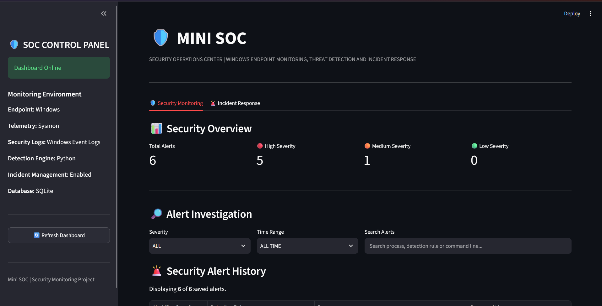
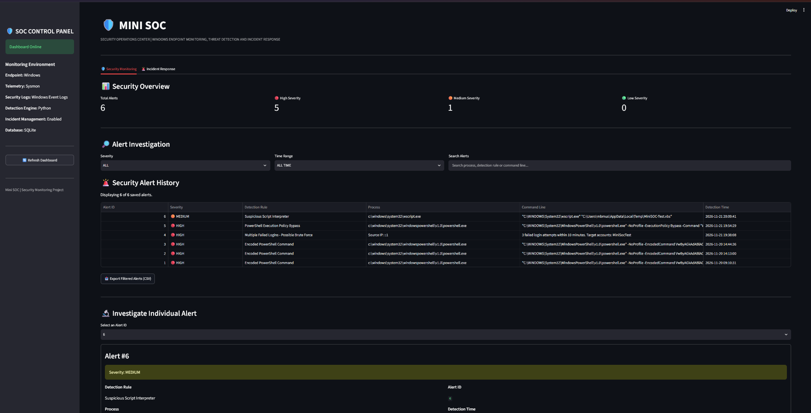
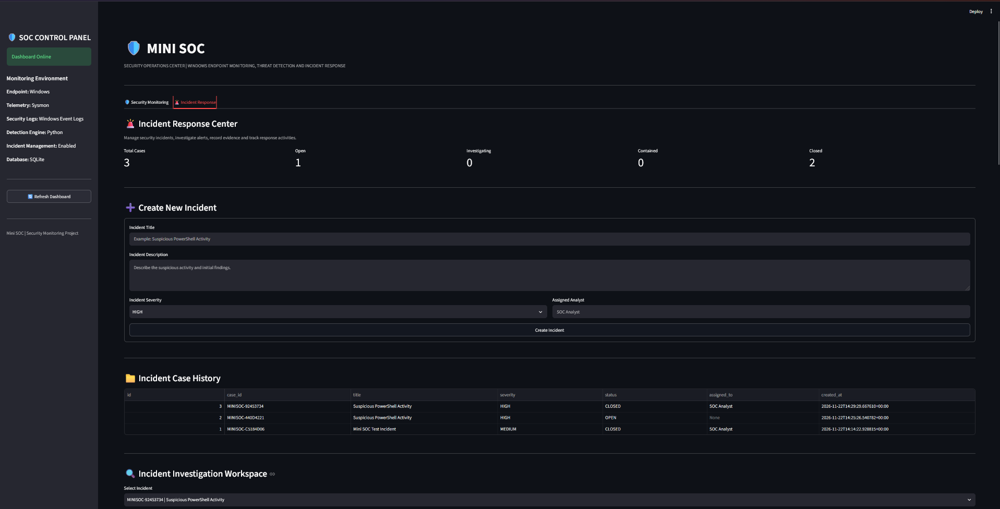
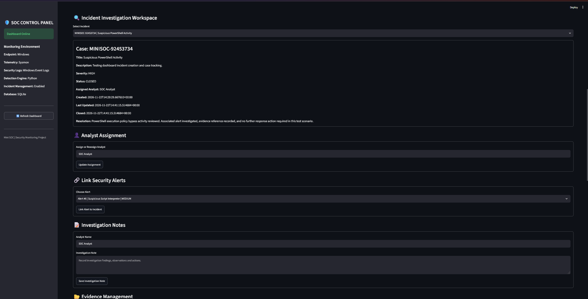
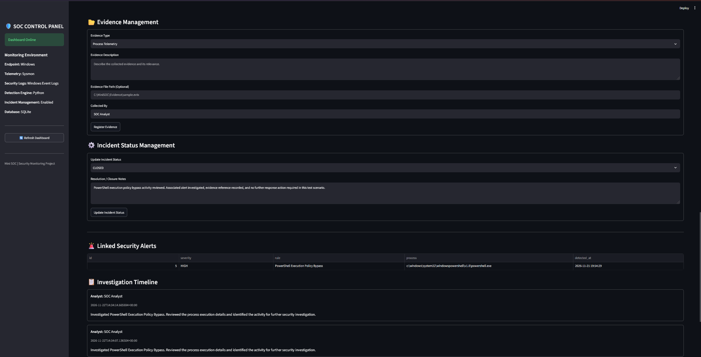

\# MiniSOC

\### Windows Security Monitoring, Detection Engineering \& Incident Response


MiniSOC is a Python-based Security Operations Center (SOC) monitoring platform built to collect, analyze, and detect suspicious activity on Windows endpoints.


The platform combines Sysmon telemetry, Windows Security Event Logs, custom detection rules, SQLite alert storage, an interactive SOC dashboard, and incident management capabilities.


This project demonstrates practical skills in \*\*Security Operations, Detection Engineering, Threat Monitoring, Alert Investigation, and Incident Response.\*\*


\---


\## Project Overview


| Attribute | Details |

|---|---|

| Project | MiniSOC |

| Platform | Windows |

| Language | Python 3.10 |

| Dashboard | Streamlit |

| Database | SQLite |

| Endpoint telemetry | Sysmon |

| Event collection | Windows Event Logs and PowerShell |

| Data processing | Pandas |


\## Key Capabilities


## Screenshots

### Security Monitoring Dashboard


### Security Analytics


### Incident Response Center


### Investigation Workspace


### Evidence Management



\### 1. Security Event Collection

\- Collects Sysmon process creation events.

\- Monitors Windows Security Event IDs 4624 and 4625.

\- Tracks successful and failed login activity.

\- Supports incremental event collection using record IDs.

\- Filters selected noisy process events.


\### 2. Detection Engineering


Custom detection rules identify:


| Detection rule | Severity |

|---|---|

| Encoded PowerShell execution | HIGH |

| PowerShell execution policy bypass | HIGH |

| Suspicious script interpreter execution | MEDIUM |

| Microsoft Office spawning PowerShell | HIGH |

| Brute-force login attempts | HIGH |

| Password spraying | HIGH |

| Successful login after brute force | HIGH |

| Remote interactive login | MEDIUM |

| External network login | MEDIUM |


\### 3. Alert Management

\- Centralized SQLite alert storage.

\- Severity-based classification.

\- Detection rule and event details.

\- Alert search and investigation.

\- CSV alert export.


\### 4. SOC Dashboard


An interactive Streamlit dashboard provides:


\- Security alert metrics.

\- Severity distribution.

\- Detection rule statistics.

\- Time-based filtering.

\- Alert search and investigation.

\- Daily security activity.

\- CSV export.


\### 5. Incident Response


The incident management module supports:


\- Security incident creation.

\- Incident severity classification.

\- Analyst assignment.

\- Alert-to-incident linking.

\- Investigation notes.

\- Evidence metadata registration.

\- Incident status tracking and resolution.


Supported incident statuses:


`OPEN` · `INVESTIGATING` · `CONTAINED` · `RESOLVED` · `CLOSED`


\---


\## System Architecture


```mermaid

flowchart TD

&#x20;   A\[Windows Endpoint] --> B\[Sysmon Events]

&#x20;   A --> C\[Windows Security Logs]


&#x20;   B --> D\[Sysmon Collector]

&#x20;   C --> E\[Security Event Collector]


&#x20;   D --> F\[Detection Engine]

&#x20;   E --> G\[Login Detection Engine]


&#x20;   F --> H\[Alert Store]

&#x20;   G --> H


&#x20;   H --> I\[(SQLite Database)]


&#x20;   I --> J\[Streamlit SOC Dashboard]

&#x20;   I --> K\[Incident Management]

```


\## Technology Stack


\- \*\*Python:\*\* Core application and detection logic.

\- \*\*Sysmon:\*\* Windows process telemetry.

\- \*\*PowerShell:\*\* Windows event log collection.

\- \*\*Streamlit:\*\* Interactive SOC dashboard.

\- \*\*Pandas:\*\* Data handling and analysis.

\- \*\*SQLite:\*\* Alert and incident storage.

\- \*\*Git:\*\* Version control.


\---


\## Project Structure


```text

MiniSoc/

│

├── alert\_store.py

├── dashboard.py

├── detection\_engine.py

├── event\_collector.py

├── incident\_manager.py

├── login\_detector.py

├── main.py

├── monitor.py

├── security\_collector.py

├── successful\_login\_detector.py

│

├── test\_dashboard.py

├── test\_incident\_validation.py

├── test\_login\_detector.py

│

├── view\_alerts.py

├── requirements.txt

├── .gitignore

└── README.md

```


\## Installation and Setup


\### Prerequisites


\- Windows 10 or Windows 11.

\- Python 3.10 or later.

\- Sysmon installed and configured.

\- Access to Windows Security Event Logs.

\- PowerShell.


\### 1. Clone the repository


```powershell

git clone YOUR\_GITHUB\_REPOSITORY\_URL

cd MiniSoc

```


\### 2. Install dependencies


```powershell

python -m pip install -r requirements.txt

```


\### 3. Start the monitoring engine


```powershell

python main.py monitor

```


\### 4. Launch the dashboard


Open another PowerShell terminal:


```powershell

python main.py dashboard

```


Access the dashboard at:


`http://localhost:8501`


\---


\## Testing and Validation


The project has undergone functional and integration testing covering:


\- Detection rule validation.

\- Malformed event handling.

\- Brute-force detection thresholds.

\- Password spraying detection.

\- Successful login correlation.

\- External IP classification.

\- Event timestamp parsing.

\- Incremental event collection.

\- Incident creation and lifecycle validation.

\- Dashboard filtering and CSV export.

\- SQLite database integrity and record preservation.


\*\*Testing distinction:\*\* Some detection scenarios were validated using synthetic events, while selected Windows process and login events were tested using real endpoint telemetry.


\## Current Limitations


\- Designed primarily for Windows endpoint monitoring.

\- Monitoring cursors are currently held in memory rather than persisted across restarts.

\- Startup event collection uses bounded baseline batches.

\- Some detection scenarios still require validation with real attack telemetry.

\- Evidence registration stores metadata and file paths; automated evidence hashing and chain-of-custody verification are not implemented.

\- This is a practical MiniSOC project, not a replacement for an enterprise SIEM.


\## Future Development


\- Persistent event-processing cursors.

\- Automated evidence hashing and integrity verification.

\- Expanded MITRE ATT\&CK mapping.

\- Additional detection rules.

\- Alert enrichment and prioritization.

\- Improved incident response automation.

\- Multi-endpoint monitoring.


\## Security and Ethical Use


MiniSOC is intended for authorized security monitoring, defensive research, and controlled laboratory environments.


Only deploy it on systems for which you have permission to collect and analyze security telemetry.


\---


\## Author


\*\*Jaafar Musa Muhammad\*\*


Cybersecurity | Security Engineering | SOC Operations | Incident Response


\- \*\*LinkedIn:\*\* \[Jaafar Musa Muhammad](https://www.linkedin.com/in/jaafar-musamuhammad6629953b8)

\- \*\*GitHub:\*\* \[jafs1942](https://github.com/jafs1942)


\---


\*Building practical security solutions through detection engineering, monitoring, and incident response.\*
